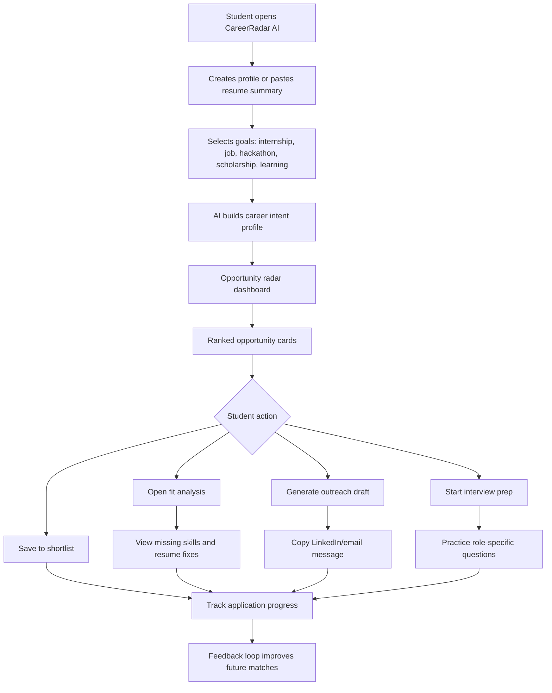

# CareerRadar AI - User Flow

## Primary path

1. Student lands on the dashboard.
2. Student adds profile details: role goal, skills, experience level, location, and resume summary.
3. CareerRadar AI generates a ranked opportunity list.
4. Student picks one opportunity.
5. Student sees why it matches, what is missing, and what to do next.
6. Student saves, applies, or prepares.

## MVP screens

- Radar dashboard.
- Profile and skill intake panel.
- Opportunity detail panel.
- Resume gap analysis.
- Outreach draft.
- Progress shortlist.

## Key product principle

Every recommendation must answer: "Why this, why me, and what should I do next?"

